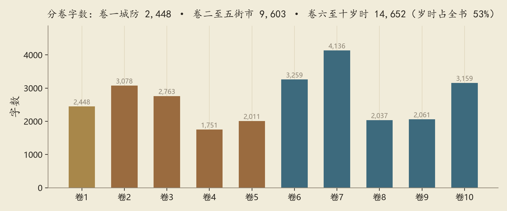
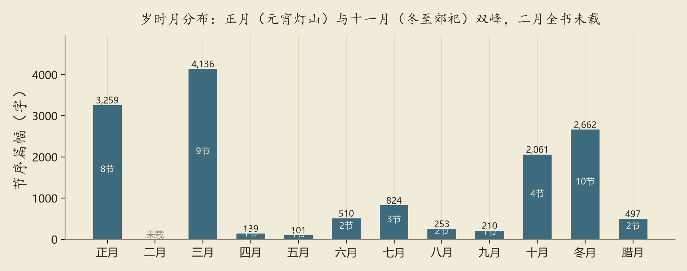
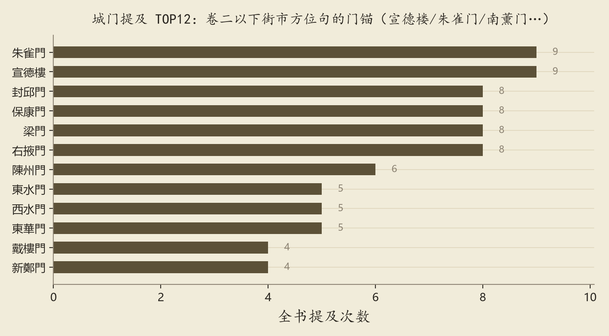

# 梦华经纬 · 文本计量（ANALYSIS）

> 全部数字出自 `python tools/stats.py` → `docs/stats.json`；前端「计量」面板只读脚本产物（`data/stats.js` 转抄）。
> 语料口径：`data/vol/*.txt` 纯正文（不含 JS 键名/导航噪声），kanripo KR2k0111 文淵閣四庫全書本（mandoku 清洗后），
> 提要+自序+十卷共 88 节。块字数不含节题字。

## 一、覆盖

| 项 | 数 |
|---|---|
| 提要+自序+十卷总字数 | 27,423 |
| 阅读块 | 88 块（2/6/8/13/12/4/8/9/10/4/12，提要自序至卷十） |
| 城门 | 34（外城 16 · 旧城 12 · 大内 6，皆卷一书证） |
| 穿城河道 | 4（蔡河/汴河/五丈河/金水河，原文明载桥 32 座） |
| 街市地条目 | 21（卷二 12 · 卷三 2 · 卷七 2 · 卷一 3 桥） |
| 岁时节序 | 43 节（卷六至十） |
| 缺字实体 | 38 处以 □ 代（kanripo &KRxxxx;，data_raw 可复核） |

## 二、正文三层结构（城的空间 → 市的空间 → 时的空间）

| 层 | 卷 | 字数 | 占比 |
|---|---|---|---|
| 城防（城郭门桥） | 卷一 | 2,448 | 8.9% |
| 街市民俗 | 卷二至五 | 9,603 | 35.0% |
| 岁时节序 | 卷六至十 | 14,652 | 53.4% |
| （提要自序） | 卷〇 | 720 | 2.6% |

《梦华录》的篇幅重心在岁时（53.4%）：孟元老以**时间**组织空间——一半以上的笔墨
给了节物风流（上元灯山、金明池争标、七夕磨喝乐、中秋新酒、除夕大傩）。城的静态
骨架（卷一）只占 8.9%，却是全书空间书写的坐标系：门与桥是卷二以下一切方位句的锚。

## 三、岁时月分布（节序篇幅，月序为示意口径）

| 月 | 正 | 二 | 三 | 四 | 五 | 六 | 七 | 八 | 九 | 十 | 十一 | 十二 |
|---|---|---|---|---|---|---|---|---|---|---|---|---|
| 节数 | 8 | 0 | 9 | 1 | 1 | 2 | 3 | 2 | 1 | 4 | 10 | 2 |
| 字数 | 3,259 | 0 | 4,136 | 139 | 101 | 510 | 824 | 253 | 210 | 2,061 | 2,662 | 497 |

双峰在**正月**（元宵灯山、车驾五岳观上清宫）与**十一月**（冬至—郊祀九节连排：
预教车象→宿大庆殿→驾行仪卫→宿太庙→青城斋宫→郊坛行礼→郊毕驾回→下赦→诣宫谢）；
三月（金明池琼林苑开放与争标百戏）为次峰。二月全书未载——如实计零。

## 四、城门提及 Top 12（空间书写的门锚）

| 门 | 全书提及 | | 门 | 全书提及 |
|---|---|---|---|---|
| 朱雀門 | 9 | | 陳州門 | 6 |
| 宣德樓 | 9 | | 東水門 | 5 |
| 封邱門 | 8 | | 西水門 | 5 |
| 保康門 | 8 | | 東華門 | 5 |
| 梁門 | 8 | | 戴樓門 | 4 |
| 右掖門 | 8 | | 新鄭門 | 4 |

宽口径单字「門」320 次、「橋」124 次——门桥句式（「出某門」「某門裏/外」「過某橋」）
是《梦华录》方位书写的语法。朱雀門/宣德樓并立第一：御街两端的城门与大内正门构成
全书空间的纵轴。

## 五、市井词频（预设词表 · 机械计数）

| 词 | 次 | | 词 | 次 |
|---|---|---|---|---|
| 門 | 320 | | 果子 | 12 |
| 橋 | 124 | | 瓦子 | 11 |
| 妓 | 23 | | 關撲 | 5 |
| 車駕 | 16 | | 夜市 | 7 |
| 州橋 | 14 | | 金明池 | 5 |
| 御街 | 13 | | 相國寺 | 9 |
| 香藥 | 13 | | 夢 | 3 |
| 宣德 | 13 | | 正店 | 10 |

汴京的商业书写以酒楼—瓦子—妓馆三角为底色（妓 23 次、瓦子 11 次、正店/脚店分层）；
仪式书写以车驾（16 次）为纲。梦华之「梦」全书仅 3 见——皆在自序（「夢遊華胥」「夢華録」
「華胥之夢」），正文不诉诸感伤，只铺陈繁华本身。

## 六、河道提及与桥谱

| 河 | 提及 | 明载桥 |
|---|---|---|
| 汴河 | 9 | 13（虹橋…西水門便橋） |
| 蔡河 | 5 | 11（觀橋…宜男橋，正名惠民河） |
| 五丈河 | 3 | 5（小横橋…染院橋） |
| 金水河 | 3 | 3（白虎橋/横橋/五王宫橋） |

四河各叙一遍（卷一河道节独揽河名本称），此后汴河以「州橋」（14 次）转喻出场——
桥比河更常被提及：交通节点才是市井记忆的坐标。

## 七、方法与边界

- 提及计数含条目自述句；「門」「橋」为单字宽口径，专用于量级对比。
- 月序为示意口径：「立冬」归十月、「冬至/郊祀」归十一月，节卡点击可回原文复核。
- 坐标全量 `src:"derived"`（示意平面米制 + 考古常识量级），本文数字不依赖坐标。
- 版本异文（如州橋夹注「正名大漢橋」，通行本作天漢橋）依四库本原样，不作校勘。
